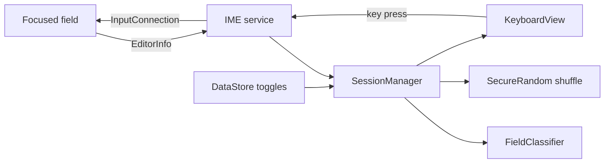

# KeyShield: Adaptive Anti-Keylogging Keyboard

**Status: v0.1.0, Phases 1-3. The Android code has not yet been compiled or run on a device.**
Only the plain-Kotlin logic in `core/` has been tested (8 JUnit tests).

## Problem and approach
On a fixed numeric keypad, tap positions reveal the digits. KeyShield is a real Android input
method (`InputMethodService`) that shuffles digit positions with `SecureRandom` for each new
number-field session.

## Build
1. Open this folder in Android Studio (JDK 17 or newer; install Android SDK 35 when prompted).
2. Let Gradle sync, then run `./gradlew testDebugUnitTest assembleDebug`.
3. APK: `app/build/outputs/apk/debug/app-debug.apk`.

Without a local SDK: push the folder to a GitHub repository root. The included workflow builds
the APK and attaches it to the run as `keyshield-debug-apk`.

## Set up on the phone
1. Install the APK and open KeyShield.
2. Tap **Enable Keyboard** and switch on KeyShield (Android shows a standard warning).
3. Tap **Select KeyShield** and choose it.
4. Focus any number field. The app does not need to stay open.

## Behaviour
| Field | Keyboard |
|---|---|
| Text, text password, unknown | QWERTY |
| Number, number password | Randomized pad |
| Decimal / signed | Randomized pad with `. ,` / `-` |
| Phone | Fixed phone pad (randomization is opt-in) |
| Date / time | Symbols page |

A layout stays put while you type. A restart of the same field keeps it; a new focus reshuffles.

## Structure (`app/src/main/java/com/keyshield/securekeyboard/`)
- `core/`: field classification, shuffling, sessions, Enter action (no Android imports)
- `keyboard/`: IME service and keyboard views
- `data/`: DataStore preferences
- `ui/`: Compose setup, toggles and test fields

## Technologies
Kotlin 2.0.21, AGP 8.7.3, Jetpack Compose with Material 3, DataStore, minSdk 26, targetSdk 35.

## Privacy and security model
No permissions (including no internet), no logging of input, no analytics, no storage of typed
text, backups disabled. Only four preference switches are saved. See LIMITATIONS.md.
